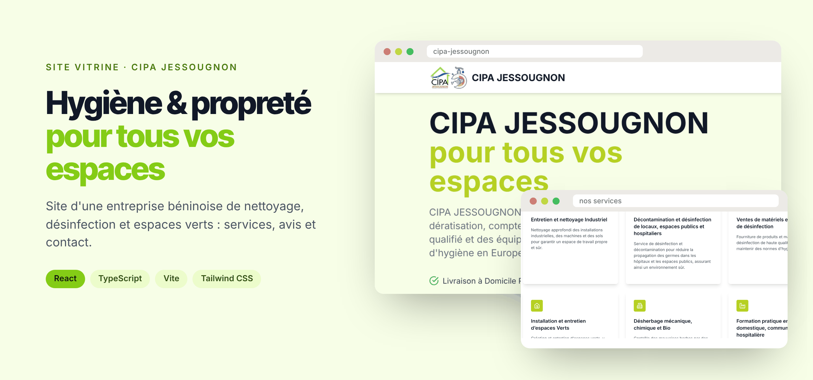

<p align="center">
  
</p>

# CIPA JESSOUGNON · Site vitrine

Site vitrine de CIPA JESSOUGNON, entreprise béninoise spécialisée dans l'entretien, la désinfection, la dératisation et l'aménagement d'espaces verts.

## Sections

- **Accueil** : présentation de l'entreprise et de ses engagements
- **Services** : nettoyage industriel, désinfection de locaux et d'hôpitaux, espaces verts, désherbage, formation en hygiène…
- **Avis** clients
- **Contact**

## Stack

React · TypeScript · Vite · Tailwind CSS · Lucide

## Lancer le projet

```bash
npm install
npm run dev
```

Puis ouvrir [http://localhost:5173](http://localhost:5173).

## Structure

```
src/App.tsx          assemblage des sections
src/components/      Navbar, Hero, Services, Testimonials, Contact, Footer
```
